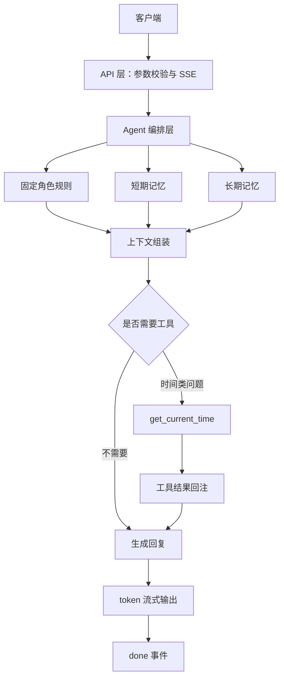

# 低延时、高一致性智能对话 Agent Demo

这是一个按题目要求实现的最小 API Demo，不依赖真实模型和 API Key。模型层用本地规则模拟流式输出，重点验证 Agent 编排链路。

## 1. 整体架构设计



### 模块职责

| 模块 | Demo 实现 |
|---|---|
| API 层 | 校验请求，把事件转换成 SSE |
| Agent 编排层 | 生成 `turn_id`、组织记忆和工具调用、输出事件 |
| 角色规则 | 固定角色“阿澄”，识别少量诱导话术 |
| 短期记忆 | `user_id + session_id` 隔离，保留最近 16 条 |
| 长期记忆 | `user_id` 隔离，保存名字和偏好，可下一轮召回 |
| 工具调用 | 时间类问题触发 `get_current_time` |
| 流式输出 | 先发 `meta`，再逐段发 `token`，最后发 `done` |

### 记忆策略

- 写入：识别“我叫 XX”“我喜欢 XX”“记住 XX”这类稳定信息。
- 检索：下一轮按“名字”“喜欢”等意图取对应记忆。
- 更新：同一用户、同一类偏好变化时递增 `version`。
- 隔离：短期记忆按用户和会话隔离，长期记忆按用户隔离。

### 工具调用机制

时间类问题先输出 `tool_call`，再执行本地时间工具，最后输出带同一个 `tool_call_id` 的 `tool_result`。工具结果进入回复生成逻辑，最终自然语言仍通过 `token` 事件流式返回。

### TTFT 优化

- 请求进入后立即返回 `meta`，不等模型生成完成。
- 回复按小块切分，逐段推送 `token`。
- 记忆读取和工具判断保持在本地，避免额外网络请求。
- Demo 的 `ttft_ms` 只表示本地模拟链路，不代表真实模型延时。

## 2. Demo 运行

```bash
python3 -m venv .venv
source .venv/bin/activate
pip install -r requirements.txt
./run.sh
```

服务地址：`http://127.0.0.1:8765`

```bash
curl -N -X POST http://127.0.0.1:8765/v1/chat/stream \
  -H 'Content-Type: application/json' \
  -d '{"query":"现在几点了？","user_id":"demo-user","session_id":"demo-session"}'
```

先写入长期记忆：

```bash
curl -N -X POST http://127.0.0.1:8765/v1/chat/stream \
  -H 'Content-Type: application/json' \
  -d '{"query":"我叫张三","user_id":"demo-user","session_id":"demo-session"}'
```

下一轮召回：

```bash
curl -N -X POST http://127.0.0.1:8765/v1/chat/stream \
  -H 'Content-Type: application/json' \
  -d '{"query":"我叫什么名字？","user_id":"demo-user","session_id":"demo-session"}'
```

## 3. SSE 事件

| 事件 | 说明 |
|---|---|
| `meta` | 本轮 `turn_id`、角色 ID 和会话 ID |
| `tool_call` | 工具调用意图 |
| `tool_result` | 工具结果，与 `tool_call` 使用同一个 ID |
| `token` | 一段自然语言回复 |
| `memory_updated` | 长期记忆写入或更新 |
| `done` | 总耗时、TTFT、工具和记忆统计 |
| `error` | 服务异常 |

## 4. 测试与边界

```bash
python3 test_demo.py
```

测试覆盖流式输出、时间工具、长期记忆下一轮召回、角色诱导防护，以及相同会话下不同用户的隔离。

边界：这是最小 Demo，长期记忆保存在进程内，服务重启后不保留；没有接入真实大模型，也没有实现生产级鉴权、重试、幂等和分布式存储。
