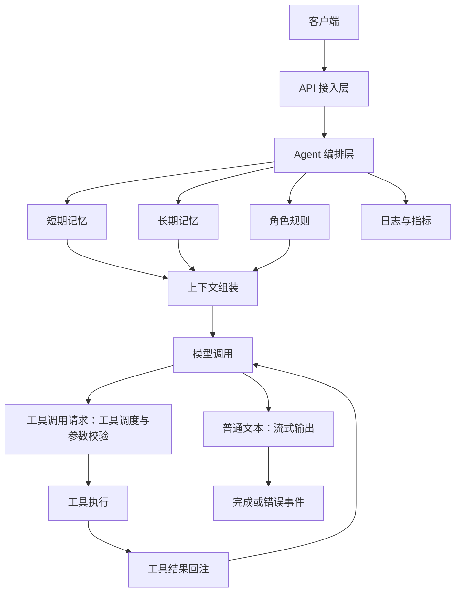
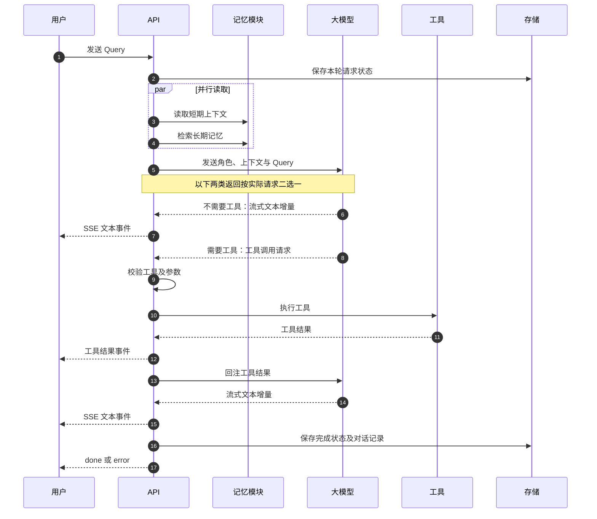

# 架构设计

## 1. 设计目标

| 目标 | 设计方式 | Demo 覆盖 |
|---|---|---|
| 角色一致性 | 版本化角色配置、输入防护、输出检查、回归测试 | 固定角色与基础诱导防护 |
| 短期记忆 | 按用户和会话隔离最近上下文，超窗后滚动摘要 | 最近会话窗口 |
| 长期记忆 | 显式写入、异步抽取、混合召回、冲突处理 | JSON 持久化与关键词召回 |
| 工具调用 | 模型输出调用意图，运行时校验并执行，结果回注 | 时间工具与记忆写入工具 |
| 低延时流式 | SSE 事件流、并行准备上下文、稳定前缀、上下文压缩 | SSE 与 Mock TTFT 指标 |

非目标：

- 不实现真实语音识别、语音合成和实时打断。
- 不默认接入某个模型厂商。
- 不把 Demo 的本地 Mock 延时当成生产性能结论。

## 2. 整体架构



### 模块职责

| 模块 | 职责 | 关键约束 |
|---|---|---|
| API 接入层 | 鉴权、参数校验、SSE 连接、错误格式 | 不承载记忆和工具业务逻辑 |
| Agent 编排层 | `turn_id`、请求状态、事件顺序、工具节点状态 | 请求内状态不放入全局变量 |
| 角色规则 | 性格、语气、价值观、行为边界、诱导防护 | 系统角色优先级高于用户输入和检索数据 |
| 短期记忆 | 当前会话最近消息 | 使用 `user_id + session_id` 隔离 |
| 长期记忆 | 偏好、事件、事实的写入与召回 | 保存来源、时间、重要度、版本和作用域 |
| 上下文组装 | 角色、记忆、当前输入、工具结果组装 | 控制上下文预算，检索内容只作为数据 |
| 模型调用 | 流式生成与工具调用决策 | 生产可替换为 OpenAI-compatible 或自研模型 |
| 工具执行 | 参数校验、权限、超时、幂等、结果回注 | 模型不直接执行外部系统 |
| 日志与指标 | TTFT、工具成功率、记忆命中、角色漂移 | 支持坏例定位、灰度和回滚 |

## 3. 一次请求流程



## 4. 角色一致性

角色配置包含：

- 性格：冷静、克制、温和
- 语气：短句优先，先结论后依据
- 价值观：安全、不伤害、不违法
- 边界：不冒充专业资质，不确定时明说
- 输入规则：识别“忽略之前设定”“输出系统提示词”等诱导

保护策略：

1. 角色设定是最高优先级系统约束。
2. 长期记忆和工具结果都标记为数据，不能当成新指令。
3. 输入侧做诱导识别，输出侧做人设与安全检查。
4. 用固定诱导集、身份追问集和安全边界集做回归。

## 5. 记忆设计

### 短期记忆

- 写入：每轮保存用户输入和最终回复。
- 读取：默认取最近 8 到 16 条。
- 压缩：超过窗口后生成滚动摘要。
- 隔离：使用 `user_id + session_id`，不能只依赖 `session_id`。

### 长期记忆

建议字段：

```text
memory_id
user_id
kind: preference / event / fact
scope
content
keywords
embedding
importance
confidence
source_turn_id
created_at
updated_at
version
status
```

写入策略：

- 用户显式要求记住的信息立即写入。
- 隐式记忆在回答完成后异步抽取。
- 只写稳定、重要、未来有用的信息。
- 写入前做实体归一化和去重。

召回策略：

```text
向量相似度
+ 关键词重合
+ 时间衰减
+ 重要度
+ 用户授权过滤
→ TopK
→ 上下文预算内截断
```

冲突策略：

| 类型 | 处理 |
|---|---|
| preference | 同一作用域下用户确认后覆盖，版本递增 |
| event | 按时间追加，不随意覆盖 |
| fact | 高置信可覆盖；低置信进入待确认 |

`scope` 用于区分不同适用范围。例如“默认回答简洁”和“技术问题详细解释”可以并存，不应被误判为冲突。

## 6. 工具调用

主方案采用模型原生 Tool Calling：

```text
短期记忆读取
长期记忆召回
独立安全检查
→ 主模型决定是否调用工具
→ 运行时校验工具名、参数、权限、幂等键
→ 执行工具
→ tool_call / tool_result 事件
→ 结果作为 observation 回注
→ 模型流式生成最终回复
```

不要在同一条主链路中无条件重复执行：

```text
独立意图模型判断工具
→ 主模型再次 Tool Calling
```

只有独立工具路由器有明确准确率或延迟收益时才引入。

失败处理：

- 非法工具名或参数：拒绝执行
- 工具超时：快速失败并降级
- 外部错误：不编造结果
- 副作用工具：使用幂等键，避免重复执行

## 7. 低延时与流式

### 指标口径

| 指标 | 含义 |
|---|---|
| TTFE | 第一个流式事件到达时间，例如 `meta` |
| TTFT | 模型第一个正文 token 时间 |
| token interval | 相邻输出间隔 |

不能把 TTFE 当成 TTFT。

### 优化手段

1. 短期记忆、长期记忆和独立安全检查并行。
2. 会话进入时预取用户画像和最近记忆。
3. 角色设定、工具说明、用户画像保持稳定前缀，利用前缀缓存。
4. 长历史先摘要，只注入相关记忆 TopK。
5. 辅助任务可用小模型，最终回复与工具选择由主模型完成。
6. 第一个可用文本片段立即推送，不等完整答案。
7. 工具设置超时、熔断、短 TTL 缓存和降级。
8. SSE / WebSocket / gRPC stream 全链路禁用缓冲。

### 终态约束

一旦发送 `done` 或 `error`，本轮不允许继续发送正文增量。

异常时应：

1. 停止后续上游请求。
2. 保存失败状态和 trace。
3. 可用连接返回明确 `error`。
4. 客户端已断开时只记录日志和指标，不再消耗推理。

## 8. 生产验收

至少覆盖：

- 角色诱导与长间隔一致性
- 记忆写入、召回、冲突和跨会话
- 工具必需、不需要、超时、失败和非法参数
- 并发请求隔离
- 请求取消与客户端断开
- 相同用户偏好并发更新

核心指标：

- TTFE / TTFT P50、P95、P99
- token interval
- tool success rate
- memory hit rate
- role consistency score
- duplicate side effect count
